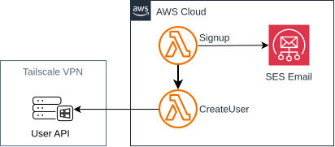
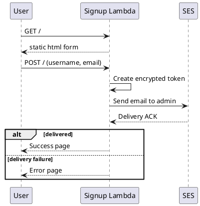
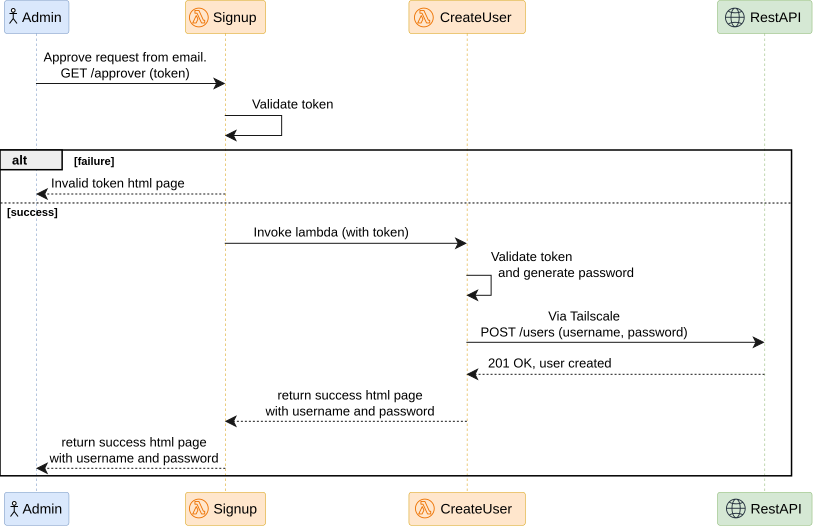

# Architecture
Two stacks exist for this project:
- 1st stack is saved under `infrastructure/`
- 1st stack is saved under `infrastructure-no-kms-ssm/`
Both share the same overall architecture



---

# Resource created

## Not managed by CloufFormation
- a deployer role and its policy 
- an S3 bucket to store the packaged code for the Signup lambda
- an ECR repo to store the docker image for the CreateUser lambda
- (**2nd stack only**) three SSM Parameter Store SecureString parameters (Fernet key, Tailscale auth key, User API password)

## Managed by CloufFormation
- Signup Lambda function (Python 3.14, reads `signup.html` from disk)
- Lambda Function URL for the Signup Lambda (public HTTPS endpoint, no API Gateway)
- CreateUser Lambda function (container image with Tailscale, Python 3.13-alpine)
- IAM roles + policies for the two lambdas (SES, Lambda invoke, Get function URL, SSM Parameter Store read, ECR pull)
- SES email identities (admin email, must be verified)
- **1st stack only** Secrets Manager secrets (Tailscale auth key, User API password)
- **1st stack only** KMS Encryption key

## Files
- `template.yaml` — CloudFormation stack definition
- `setup-parameters.sh` — Creates SSM SecureString parameters (2nd stack only)
- `first-deploy.sh` — Creates all resources not managed by cfn (run before deploying)
- `deployer-policy.json` — IAM policy for the CloudFormation deployer role
- `lambda/signup.py` — Signup Lambda handler
- `lambda/signup.html` — Signup page (edit this to change the UI)
- `lambda_create_user/Dockerfile` — CreateUser Lambda container image
- `lambda_create_user/bootstrap` — Tailscale startup script
- `lambda_create_user/fetch_authkey.py` — SSM Parameter Store auth key fetcher (runs at cold start)
- `lambda_create_user/create_user.py` — CreateUser Lambda handler
- `lambda_create_user/requirements.txt` — Python dependencies

---

# Cost

| Resource | Free tier | Typical monthly cost |
|----------|-----------|---------------------|
| **CloudFormation** | **Always free** — no charge for stacks | $0|
| Lambda Function URL | Free (included with Lambda) | $0|
| Lambda | 1 M requests + 400K GB-seconds/month (12 months) | ~$0 after free tier |
| SES | 62K emails/month (from Lambda) | ~$0 |
| S3 | $0.023 per GB | ~$0 |
| SSM Parameter Store | 10,000 parameters/month (free tier) | $0|

**1st stack only**:
- Secrets Manager Secret Storage: **$0.40** per secret per month
- KMS Customer Managed Keys: **$1.00** per month per key

---

# Sequence diagrams

**User signup diagram**:


**Admin approving a request diagram**:



---

# Infra explained
## How approve/deny tokens work

When a user signs up, the Lambda encrypts the user's email and username with Fernet symmetric encryption. The Fernet key is stored in SSM Parameter Store SecureString and fetched at Lambda cold start. The encrypted payload becomes the `token` parameter in the approve/deny links. On click, the CreateUser Lambda decrypts the token with Fernet to recover the payload, generates a random password, and calls the user API over Tailscale.

- Only someone with the Fernet key can forge a valid token
- The key is stored in SSM SecureString (encrypted at rest with AWS-managed key)
- No KMS costs — Fernet is pure Python symmetric encryption

## How secrets are stored

All secrets are stored in SSM Parameter Store as SecureString parameters. They are **not**
in any Lambda environment variable or CloudFormation parameter. At cold start:

- **Fernet key:** Both Lambdas fetch the key from SSM Parameter Store on first use and cache it in memory.
- **Auth key:** The bootstrap script runs `fetch_authkey.py` which reads the key from SSM Parameter Store,
  writes it to a temp file, and `tailscale up` reads it from there. The file is deleted
  immediately after.
- **API password:** The Lambda handler fetches it from SSM Parameter Store on first invocation and caches
  it in memory for the container's lifetime.

## Stack parameters

| Parameter | Description |
|-----------|-------------|
| `FromAdminEmail` | SES sender email (must be verified) |
| `ToAdminEmail` | SES recipient email (optional, defaults to From) |
| `UserApiBaseUrl` | URL of the WebDAV User API on your tailnet (e.g. `http://my-server:3000`) |
| `UserApiUsername` | Basic auth username for the API |
| `Architecture` | Lambda architecture: `arm64` or `x86_64` (default `x86_64`) |

**SSM Parameter Store parameters (created by setup script before deploy):**

| Parameter | Description |
|-----------|-------------|
| `/home-cloud/fernet-key` | Fernet encryption key for tokens |
| `/home-cloud/tailscale-auth-key` | Tailscale ephemeral auth key (`tskey-auth-...`) |
| `/home-cloud/admin-api-password` | Basic auth password for the User API |

---

## Get the signup URL

```bash
aws cloudformation describe-stacks \
  --stack-name home-cloud \
  --query 'Stacks[0].Outputs[?OutputKey==`SignupUrl`].OutputValue' \
  --output text
```

Share this URL with users. Visiting it shows the signup form.

---

## Updating the stack

Edit `template.yaml` or `lambda/` files, then re-run the package + deploy commands. CloudFormation will update only the changed resources.

---

## Editing the signup page

If you edit `signup.html`, then re-run the package + deploy commands. The HTML is read from disk at Lambda cold start, so changes take effect on the next deployment.

---

## Updating the create user lambda

If you change files in `lambda_create_user/`, rebuild and push the Docker image, then update the Lambda function code:

```bash
ECR_URI="${ACCOUNT_ID}.dkr.ecr.${AWS_REGION}.amazonaws.com/home-cloud-ecr-repo"
docker buildx build --provenance=false \
  -t ${ECR_URI}:latest \
  -f infrastructure-no-kms-ssm/lambda_create_user/Dockerfile \
  infrastructure-no-kms-ssm/lambda_create_user/
docker push ${ECR_URI}:latest

# Force Lambda to use the new image
aws lambda update-function-code \
  --profile admin \
  --function-name home-cloud-create-user-lambda \
  --image-uri ${ECR_URI}:latest \
  --publish
```

---

## Rotating the Fernet key (2nd stack only)

If you need to rotate the Fernet key (e.g., suspected compromise):

```bash
# Generate a new key
NEW_KEY=$(python3 -c "from cryptography.fernet import Fernet; print(Fernet.generate_key().decode())")

# Update SSM parameter
aws ssm put-parameter \
  --profile admin \
  --name /home-cloud/fernet-key \
  --value "$NEW_KEY" \
  --type SecureString \
  --overwrite

# Force Lambda to pick up the new key (cold start)
aws lambda update-function-configuration \
  --profile admin \
  --function-name home-cloud-signup-lambda \
  --environment Variables="{FERNET_KEY_PARAM=/home-cloud/fernet-key}" \
  --no-cli-pager
```

> **Note:** Rotating the key invalidates all existing approve/deny links. Users who click old links will see "Invalid or expired link."
